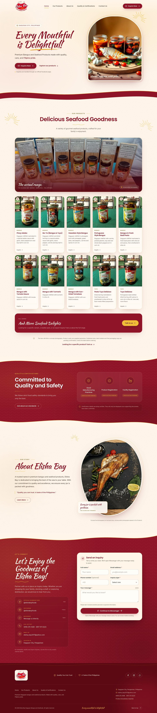
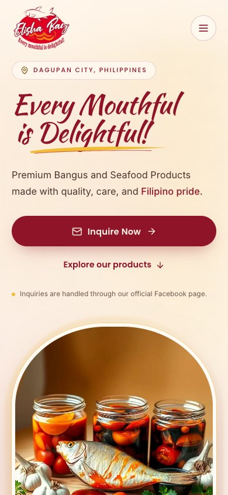

# Elisha Bay — Official Website

A single-page brand and lead-generation site for **Elisha Bay Dagupan Bangus and Seafoods**, built around the supplied landing-page reference. The direction is a premium Filipino seafood brand: warm cream, deep burgundy, golden accents, editorial photography, and hand-painted details.

> **Every mouthful is delightful. Every interaction should feel just as delightful.**



<p>
  
</p>

---

## Development workflow

This repo uses a deliberately small agentic loop: **PM → software engineer → QA → human merge**.

- [AGENTS.md](AGENTS.md) — the entry point: commands, content guardrails, rules and definition of done.
- [product-spec.md](product-spec.md) — user stories, acceptance criteria and non-goals.
- [_docs/process.md](_docs/process.md) — roles, permissions, grooming, QA verdict format and escalation.
- [_docs/team/](_docs/team/) — [PM](_docs/team/pm.md), [software engineer](_docs/team/software-engineer.md) and [QA](_docs/team/qa-engineer.md) definitions.
- [_docs/testing-guidelines.md](_docs/testing-guidelines.md) — what the browser suite proves and what QA checks manually.
- [_docs/handoff.md](_docs/handoff.md) — current state, decisions, traps and next action.
- [_docs/backlog.md](_docs/backlog.md) — the P0 content intake and next engineering tasks.

The rule is simple: **the agent that writes the code does not decide whether it is correct.** The
human owner approves claims and merges; QA starts from a fresh context and verifies every AC against
the running site. The current repository is local git with a human merge gate; when a remote is
added, use the ready-made CI and PR templates.

---

## Run locally

```bash
make install       # npm install
make dev           # Vite at http://localhost:5173
make verify        # typecheck + production build + Playwright/axe QA suite
```

Or use the npm scripts directly:

```bash
npm run dev
npm run build
npm run typecheck
npm run test:e2e
```

The browser suite uses installed Chrome locally and Playwright’s pinned Chromium in CI. It covers
the product-to-inquiry handoff, form validation, mobile menu, responsive overflow, WCAG A/AA
accessibility, the skip link and reduced motion.

**Stack:** Vite, React 19, TypeScript, Tailwind CSS v4, Lucide icons, Playwright + axe. No router,
cart, payment, backend or checkout — this phase is intentionally a brand/lead-generation page.

---

## Project structure

```text
public/
  logo/                   official transparent lockup (256/512/1024 WebP + PNG fallback)
  images/                 10 real packshots, range photo, concept hero/about, paper grain
  favicon-32.png          logo-derived favicon
  apple-touch-icon.png    logo-derived Apple icon
  icon-192.png
  icon-512.png
  og-image.jpg            1200x630 share card with the official logo
  site.webmanifest
  robots.txt
src/
  components/
    Navbar.tsx            sticky nav, scroll spy, mobile menu, focus trap
    HeroSection.tsx
    ProductsSection.tsx   actual range banner + 10 product image cards + CTA
    QualitySection.tsx    certification placeholders (not claims)
    AboutSection.tsx      brand story + expandable values
    ContactSection.tsx    contact channels + inquiry form
    InquiryForm.tsx       validation + Messenger handoff
    Footer.tsx
    Logo.tsx              official logo image lockup
    Decor.tsx             sunburst, brush stroke, gold rule
    Waves.tsx             organic section dividers
  data/
    products.ts           supplied product names, descriptions and packshots
    site.ts               brand, links, contact, credentials
  hooks/                  reveal, scroll state, scroll spy
  App.tsx
  index.css               design tokens + shared styles
  main.tsx
tests/
  e2e/landing.spec.ts     Playwright QA suite (14 tests)
_docs/
  process.md              roles, permissions and PM → engineer → QA loop
  team/                   pm.md, software-engineer.md, qa-engineer.md
  testing-guidelines.md
  design-system.md
  handoff.md
  backlog.md
  ai-usage-report.md
  task-template.md
.agents/agents/           PM, engineer and QA subagent definitions
.github/                  CI + issue/PR templates
assets/brand/             supplied logo, product-line and 10 packshot sources (not served)
AGENTS.md                 agent entry point and guardrails
product-spec.md           behaviour, ACs, invariants and non-goals
playwright.config.ts
Makefile
```

---

## Content and asset status

This build intentionally withholds unverified business details.

### Logo and identity

The **official supplied Elisha Bay logo** is integrated from `assets/brand/elisha-bay-logo-source.jpg`. The build uses transparent, optimized variants in `public/logo/`; the header and footer render the full lockup, and the favicon, app icons and share image are derived from the same asset. Do not recolor, crop or replace the mark without the owner’s approval. If a vector SVG is supplied later, swap the image sources and regenerate the icons.

### Product line

`src/data/products.ts` contains the ten products shown in the supplied packshots and range signs: **Pinoy Adobo, Ba-Yo, Hawaiian Style Bangus, Portuguese Style Bangus, Bangus in Fresh Basil Pesto, Bangus with Tomato Sauce, Bangus with Turmeric, Bangus with Sun-Dried Tomatoes, Pesto Tuyo Delizioso** and **Tuyo Delizioso**. Each card uses its supplied packshot; the range photograph opens the section and a full-range enquiry strip closes it.

Printed sizes, batch details, exact packaging copy and prices are still pending confirmation and are intentionally not repeated in text. The hero still-life remains concept photography; the range and card packshots are actual.

### About copy

The About paragraph is the proposed marketing copy from the handoff. It is not verified company history and should be replaced or approved by Elisha Bay.

### Certifications

The Quality section deliberately displays neutral credential slots marked **“Verification pending.”** It does **not** display FDA, US FDA, GMP, or other official marks or claims. When the client supplies supporting documents and confirms the exact wording, update `src/data/site.ts`:

- `credentials` — labels, statuses and descriptions
- `credentialsVerified` — set to `true` after sign-off
- Replace the placeholder medallions only with approved, documented badges

Do not add government logos or certification seals without written permission and verification.

### Contact details

Confirmed contact channels are configured in `src/data/site.ts`:

- Mobile: **0919 270 1448** · **0917 511 0223**
- Email: **elisha_bay2017@yahoo.com**
- Facebook / Instagram: **@elishabayfoods**
- Messenger: `https://m.me/elishabayfoods`

The street address is still pending and intentionally not displayed. Add it to `site.contact` when supplied. The contact section and footer render the phone, email and Instagram data automatically.

### Inquiry workflow

The form validates name, email, optional phone, inquiry type, and message. On success it opens the official Messenger page in a new tab with the full inquiry pre-filled. The success panel lets the visitor reopen Messenger or copy the message as a fallback if the tab is blocked.

There is no server-side form submission in this phase. If email notification or a CRM integration is required, add an endpoint and keep the Messenger path as a fallback.

### Photography credits

- Official Elisha Bay logo: supplied by the brand owner; transparent, icon and share variants derived from the supplied file.
- Product range photograph: supplied by the brand owner (`assets/brand/elisha-bay-products-lineup-2026.jpg`); cropped and color-graded for the Products section. The trade-show context and visible third-party leaflets are excluded from the site crop.
- Product card packshots: supplied by the brand owner (`assets/brand/products/`); lightly graded and cropped to a 3:4 card frame. The green factory/display background is part of the supplied photographs.
- Hero still-life: generated concept photography, not actual Elisha Bay packaging. It remains the interim hero until a styled brand shoot is available.
- About food photograph: [Unsplash image source](https://images.unsplash.com/photo-1644784643137-b9073dd262f6), used under the Unsplash License. Confirm and add photographer credit before launch.

The product disclaimer in the UI states that the hero still-life is concept photography, the cards use supplied packshots, and sizes/batch details are pending confirmation. Replace the concept hero with approved brand photography before launch.

---

## Brand tokens

Defined in `src/index.css`:

| Token | Value | Use |
| --- | --- | --- |
| `--color-cream` | `#FFF5E9` | page background |
| `--color-burgundy` | `#8F1427` | headers, quality/contact sections |
| `--color-burgundy-deep` | `#5C0914` | footer, depth |
| `--color-crimson` | `#B50918` | primary CTA hover/errors |
| `--color-gold` | `#F2BD36` | accents, underlines, seals |
| `--color-charcoal` | `#252525` | strong text |
| `--color-bark` | `#4A332D` | body text |

**Type:** Kaushan Script for brand statements only; Poppins for headings, labels, and navigation; Inter for body copy. Decorative type is never used for paragraphs, navigation, or product descriptions.

---

## Accessibility and SEO

- Semantic landmarks, one `h1`, labelled sections and form fields.
- Skip link, visible `:focus-visible` rings, reduced-motion support.
- Mobile menu has `aria-expanded`, Escape-to-close, focus return, and a simple tab trap.
- Form errors use `aria-invalid`, `aria-describedby`, and a polite live region.
- Images have descriptive alt text; decorative SVGs are `aria-hidden`.
- Responsive from 320px upward, with automated overflow checks at 320 / 375 / 414 / 768 / 1024 / 1440 / 1920.
- Metadata, Open Graph/Twitter cards, favicon, web manifest, and Organization JSON-LD are included.
- Responsive WebP assets with JPEG fallbacks, explicit dimensions, and LCP preload for the hero.

### Before launch checklist

- [ ] Confirm the printed sizes, batch details and exact packaging copy (packshots are supplied; see [backlog](_docs/backlog.md)).
- [ ] Commission the real hero still-life (three hero jars, label-forward, negative space for the headline).
- [ ] Approve or rewrite the About copy.
- [ ] Confirm certification wording and documents; update or remove the “verification pending” slots.
- [ ] Supply phone, email, and full address.
- [ ] Confirm the Facebook/Messenger URLs with the client.
- [ ] Set the canonical URL and make `og:image` / `og:url` absolute for the live domain.
- [ ] Add analytics/cookie consent only if required by the deployment jurisdiction.
- [ ] Re-run `make verify`, test the form handoff on a real phone, and verify the production URL in social previews.

---

## Reference

The supplied visual reference is kept at the project root:

`a_clean_modern_appetizing_landing_page_website_m.png`
