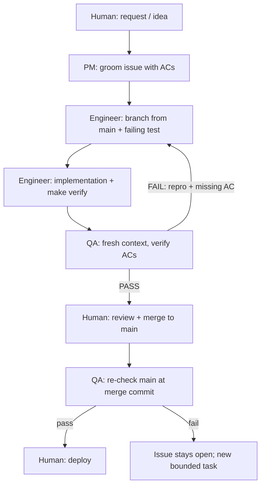

# Agent Team and Process

How work moves from an idea to a merged, verified change on the Elisha Bay site. The workflow is
trimmed to the three roles this project needs — **PM, software engineer and QA** — plus the human
owner who approves content and merges.

The rule behind the design: **the agent that writes the code does not decide whether it is
correct.** Everything else follows from it.

## 1. The team

| Role | Responsibility | Owns | Does not do |
| ---- | -------------- | ---- | ----------- |
| **Human owner** | Approve content, claims and contact details; review the diff; merge to `main`; deploy | spec approval, factual claims, production, DNS, merge | Delegate a pass/fail verdict to the engineer |
| **PM** | Turn a request into a ready issue with checkable acceptance criteria; keep the backlog ordered | `product-spec.md`, issue text, `_docs/backlog.md` | Write or review code; approve claims without a source |
| **Software engineer** | Implement one groomed issue on a branch from current `main`; failing test first; smallest passing change; open a PR when a remote exists | application code, tests for the slice, `_docs/handoff.md` updates | Merge, close issues, invent claims, edit the spec |
| **QA** | Independently verify every AC against the running site; run the suite; post PASS/FAIL with evidence | `tests/e2e/`, the verdict comment | Fix code; merge; approve content; re-run only the tests it likes |

Role definitions:

- [PM](team/pm.md)
- [Software engineer](team/software-engineer.md)
- [QA](team/qa-engineer.md)

Discoverable subagent definitions live in `.agents/agents/*.md`. They are short pointers to the
role docs, so a fresh agent can be started with its role and the issue without inheriting the
engineer’s reasoning.

## 2. Current repository mode

The repo is **local git with a human merge gate**. There is no remote yet. Until one is added:

- Work on a branch from `main`; the human owner merges locally.
- No PR is required, but the same evidence must be recorded in the issue or handoff.
- `make verify` is the gate; `CI` is ready in `.github/workflows/ci.yml` for the day the repo is
  pushed.

When a remote exists:

- Engineer opens a PR with `Refs #N` (never a close keyword).
- QA posts its verdict on the PR/issue.
- The human owner merges; QA re-checks `main` at the merge commit.
- CI runs typecheck, build and the Playwright/axe suite.

## 3. Permissions

| Capability | Human | PM | Engineer | QA |
| ---------- | :---: | :--: | :------: | :-: |
| Read repo, spec and issues | ✅ | ✅ | ✅ | ✅ |
| Write spec / issues / backlog | ✅ | ✅ | ❌ | ❌ |
| Write application code | ✅ | ❌ | ✅ | ❌ |
| Write tests | ✅ | ❌ | ✅ | ⚠️ may add tests only with an issue; fixing ends independence |
| Run the app, tests and accessibility audit | ✅ | ✅ | ✅ | ✅ |
| Post the PASS/FAIL verdict | ✅ | ❌ | ❌ | ✅ |
| Merge to `main` | ✅ | ❌ | ❌ | ❌ |
| Deploy / DNS / publish claims | ✅ | ❌ | ❌ | ❌ |

Permissions are enforced by the human merge gate, not by a badge on a document. If a remote is
added, protect `main`, require CI and require human approval; QA never gets merge rights on this
repo.

## 4. Grooming

A request is not work until it has a groomed issue. Use [`task-template.md`](task-template.md):

- **Goal** — the outcome, not a file list.
- **Acceptance criteria** — each one checkable, each mapped to an AC id in
  [`product-spec.md`](../product-spec.md).
- **Out of scope** — the tempting adjacent work, with a follow-up issue if it matters.
- **Constraints** — files, libraries, design rules, content rules and the proof command.
- **Human checkpoints** — anything involving certifications, contact details, company history,
  pricing, packaging or official assets.

An issue that is not groomed does not go to an engineer. If an AC is ambiguous, the engineer stops
and asks; it does not guess.

## 5. The loop

One issue per engineer at a time. Two QA cycles maximum, then the human decides.



1. **PM grooms.** The issue gets a goal, ACs, out-of-scope and constraints. Content claims are
   flagged for human approval.
2. **Engineer implements.** Fetch/update `main`, branch as `feat/<issue>-<slug>`, write a failing
   test first, then the smallest change. Run `make verify`. Commit. Open a PR if a remote exists,
   otherwise report the branch and evidence.
3. **QA verifies.** Fresh context. Read the issue and the spec, not the engineer’s reasoning. Run
   `make verify`. Walk the ACs against the running site, including keyboard, mobile and content
   checks. Post the verdict.
4. **Human merges.** On PASS, review the diff and merge to `main`. The engineer never merges. On
   FAIL, the engineer gets one bounded fix; a second FAIL escalates to the human.
5. **Post-merge check.** QA (or the human) re-runs `make verify` on `main` at the merge commit. The
   issue closes only if that passes.

## 6. QA verdict format

QA posts one comment with a fixed shape:

```markdown
## QA: PASS

- [x] US2-AC1 Four product cards render — PASS
- [x] US4-AC3 Valid inquiry opens Messenger pre-filled — PASS
- [x] US5-AC3 axe reports no WCAG A/AA violations — PASS

Tests: `make verify` — typecheck, build and 11 Playwright tests passed
Manual: 390px menu/Escape/focus; desktop product hover/focus; certification wording scan
Branch: `feat/42-product-content`
```

On failure:

```markdown
## QA: FAIL

- [x] US2-AC1 Four cards render — PASS
- [ ] US4-AC3 Messenger handoff — FAIL
      Submitted the form; no success region appeared and `window.open` was not called.

Tests: `make verify` — 10 passed, 1 failed (`product card pre-fills...`)
Evidence: `test-results/.../test-failed-1.png`
```

Rules: `PASS`/`FAIL` on the first line; every AC gets a verdict; every failure says what was done and
what happened; include the test command/result and any manual evidence. QA does not change product
code.

## 7. Content safety gate

This site makes trust claims. Before any change that touches copy, certifications, contact details,
product information or imagery, the human owner must confirm:

- **Certifications:** the exact wording and supporting document; no FDA/US FDA/GMP marks while
  `credentialsVerified` is false.
- **Contact details:** the real phone, email and address; do not infer them.
- **Product facts:** names, ingredients, sizes, prices and packaging only from approved material.
- **Company history / About copy:** client-approved, not reconstructed from memory.
- **Imagery:** real Elisha Bay assets or clearly disclosed placeholders.

If an issue cannot meet this gate, the PM rewrites it or the engineer stops. “It looks plausible” is
not a source.

## 8. Evidence trail

```text
issue / groomed brief
  → branch from current main
  → failing test observed and recorded
  → implementation + make verify output
  → QA verdict (AC-by-AC)
  → human merge
  → post-merge make verify
  → AI usage report entry
```

Handoffs are files, not conversation:

| From → To | Artifact | Where |
| --------- | -------- | ----- |
| Human → PM | request / idea | issue |
| PM → Engineer | groomed issue with ACs | issue + spec |
| Engineer → QA | branch, failing test, `make verify` evidence | issue / PR |
| QA → Human | PASS/FAIL with AC proof | issue / PR |
| Engineer → Human | mergeable diff + handoff notes | branch / `_docs/handoff.md` |
| Anyone → next session | what changed and how it was checked | `_docs/ai-usage-report.md` |

## 9. Escalation

| Signal | Route |
| ------ | ----- |
| ACs ambiguous, contradictory or missing a source | Back to PM; engineer stops |
| Certification/contact/company-history question | Human owner; do not invent |
| QA fails twice on the same issue | Human reviews both verdicts and the diff |
| Test is flaky or CI is red for an unrelated reason | Fix the test/pipeline in its own issue; never skip |
| A request grows beyond the issue | New issue; do not widen the diff |
| Anyone proposes a cart, checkout or payment | Reject for this phase; not a PM decision |

## 10. Known failure modes

- **Self-approval.** QA must be a fresh context with the running site and ACs, not the engineer’s
  explanation.
- **Fabricated trust.** Agents fill gaps with plausible certifications or contact details. The
  content safety gate and US3/US4 tests exist to stop that.
- **Green-but-hollow tests.** A test that never failed proves nothing; observe it red first. Do not
  weaken an assertion to make CI green.
- **Placeholder drift.** Product imagery and About copy are placeholders; replacing one without
  updating the disclaimer or spec is a defect.
- **Scope creep.** No e-commerce, CMS, analytics or backend unless a human-approved issue changes
  the spec.
- **Skipped human gate.** A passing QA run is evidence, not permission to merge. The human owner
  merges.

## 11. Definition of done

The checklist lives in [`AGENTS.md`](../AGENTS.md) so every agent reads it at the entry point. In
short: every AC proved, `make verify` green, no invented claims, accessibility/responsive checks
done, docs updated, QA PASS posted, human merged.
